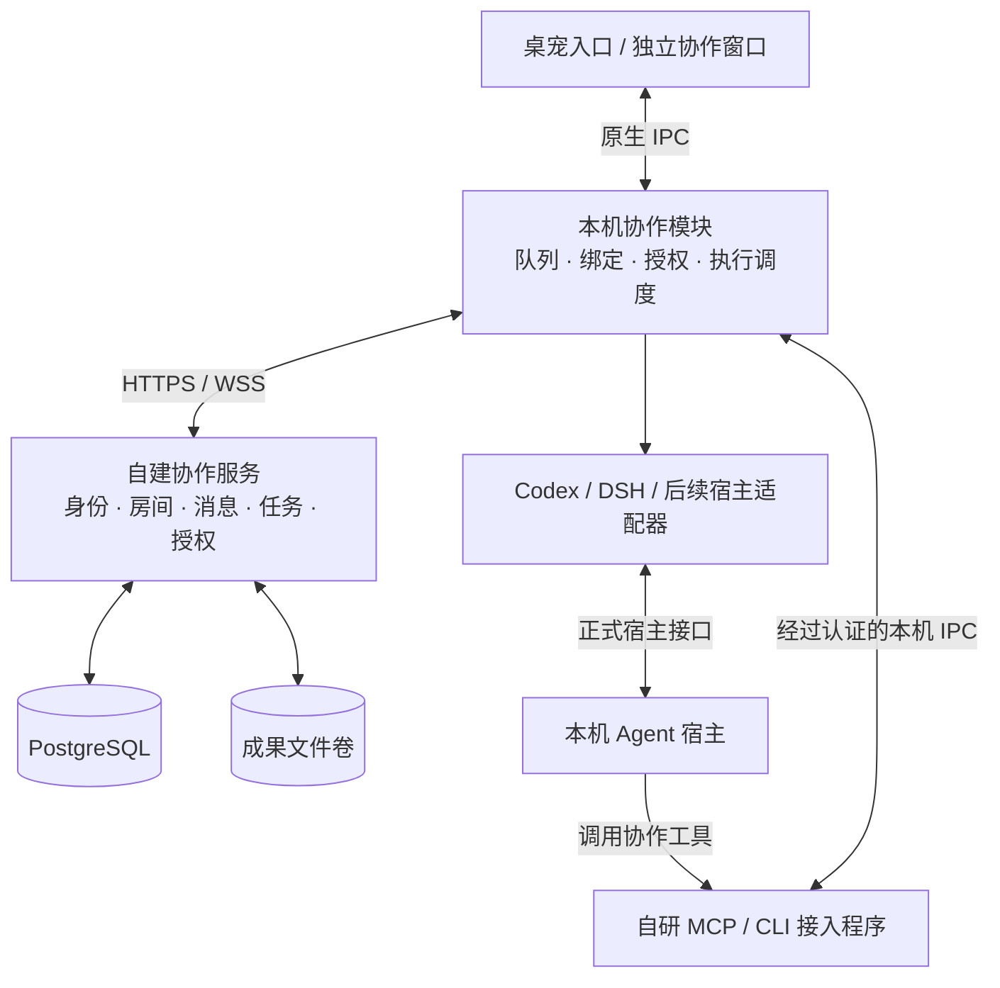

# EM Use 多人 Agent 协作 · 第一版设计

- 日期：2026-10-24。
- 状态：设计草案，供范围评审和开发拆分；尚未实现、部署或完成真实宿主联调。
- 适用端：自建服务端、EM Use Rust/Tauri 桌面端、Agent 接入组件。
- 读者：产品、前后端开发、Agent 适配开发、测试及部署维护人员。

## 1. 目标与已确定方向

让使用不同 Agent 的同事进入同一个项目房间，交流问题、交换证据、分工执行任务，并由各自桌宠提示进度、待确认事项和成果。用户继续使用自己的 Agent、模型账户与本地项目。

已确定的方向：

- 房间、协作服务、客户端和接入层自行开发、自行部署，不直接采用 agent-room 产品或服务。
- 兼容目标包含 Codex、DeepSeek Harness（下称 DSH）、WorkBuddy、内部客户端 AiWork，以及实际使用的 IDE Agent 插件。
- 桌宠承担个人入口和提醒，独立房间窗口承担完整协作界面。
- 当前工作只产出设计文档，不创建服务、不修改业务代码、不安装连接器、不调用模型执行任务。

本文中的技术选型、默认限制和实施顺序是建议方案，不代表已获独立产品评审通过。第一版按单组织、受邀成员、可信内网或 VPN 下的团队试点设计。

### 1.1 第一版的成功标准

至少两位真实用户，在两台电脑上使用不同宿主，共同完成一次真实项目问题处理：创建房间 → 绑定 Agent → 发布问题 → 领取任务 → 执行或讨论 → 回传证据 → 人工验收。另验证一个仅通过 MCP、由用户主动触发的宿主能参与同一流程。

示例：前端同事的 Codex 分析页面调用，后端同事的 DSH 分析接口实现；双方在房间交换契约和错误证据，各自在授权目录中形成修改或建议，提交验证结果后由任务发布者验收。

不要求所有 Agent 同时发言，也不把安装软件、建立连接或模型自称完成视为任务完成。

## 2. 第一版范围

### 2.1 必须交付

| 功能 | 第一版行为 | 范围边界 |
| --- | --- | --- |
| 协作身份 | 管理员邀请创建协作账户，登录、退出、撤销设备 | 不自动把额度账户或咚咚账户当作协作身份 |
| 项目房间 | 创建、邀请成员、退出、移除成员、归档 | 一个项目一个主房间；不做跨组织和公开大厅 |
| 成员与 Agent | 展示所有者、宿主、设备、接入能力、连接状态 | 一个人可注册多个 Agent；连接正常不等于正在执行 |
| 房间对话 | 文本、回复、明确提及、增量历史和未读 | 附件第一版仅支持受限成果文件，不做通用 IM |
| 项目背景 | 人工维护项目说明、接口约定、验收标准，保留版本 | Agent 可读取，不能自行覆盖共同约定 |
| 任务 | 人发布、指定 Agent 或开放领取、接单、进度、阻塞、失败、取消、提交、验收 | 单任务一个执行负责人；分工通过多个关联任务实现 |
| 成果 | 文本结论、受限文件、代码差异文件、HTTP(S) 链接、验证记录 | 不自动合并代码、不自动发布、不自动执行附件 |
| 通用接入 | 自研 MCP 工具和轻量 CLI，使用同一业务协议 | CLI 是调用协作工具的入口，不是万能宿主控制器 |
| 执行适配 | Codex、DSH 专用协作会话；启动、续接、取消、事件及必要审批 | 仅对实际通过验证的版本和平台开放 |
| 桌宠入口 | 设置、托盘、共享操作入口打开房间，提示提及、待确认、失败及提交结果 | 不替换额度形态，不强制统一角色动画 |
| 可靠性 | 持久化消息、消费位置、幂等发送、任务占用、断线恢复、未知结果核对 | 断线不会自动把任务重新派给另一台机器 |
| 管理与部署 | 成员停用、设备撤销、房间归档、基础审计、备份与恢复 | 单实例部署，无联邦、无复杂租户计费 |

### 2.2 接入覆盖要求

第一版必须交付 Codex 与 DSH 的执行适配，以及通用 MCP/CLI 接入。在 WorkBuddy 和团队实际使用的一个 IDE 插件上分别完成 MCP 收发与任务回传验证；具体 IDE 插件名称在接入盘点时确认。

AiWork 作为内部宿主：第一版完成接口盘点、接入契约和安装说明；若现有版本支持 MCP，则纳入通用接入验证。若需要内部团队新增接口，开发和联合验收单独列项，未完成时明确展示“待接入”，不阻塞基础试点，也不宣称全宿主兼容。

### 2.3 本版不做

- 跨组织联邦、公开房间、多人实时语音、视频、完整企业 IM。
- 3D 虚拟办公室、桌宠在他人桌面移动、跨设备同步角色动作。
- 自动经理 Agent、自动拆解并无限派发任务、无人约束的群聊接龙。
- 抓取所有私人会话、复制模型凭据、修改宿主私有数据库、模拟键盘接管任意聊天窗口。
- 无条件接管 IDE 或桌面客户端正在运行的会话。
- 中央服务器代替大家登录模型账号，或集中汇总所有人的额度。
- 云端统一代码工作区、自动提交／推送／合并、生产部署、跨平台任意远程命令接口。
- 浏览器/PWA 独立客户端、移动端、完整组织 SSO；协议保留后续扩展空间。

## 3. 核心概念与用户流程

### 3.1 对象关系

| 对象 | 含义 |
| --- | --- |
| 用户 User | 经过服务端认证的真实成员，拥有自己的 Agent |
| 设备 Device | 已授权的桌宠安装实例，有独立设备身份和撤销状态 |
| AgentInstance | 房间中的 Agent 身份，归属一个用户和设备，声明宿主及能力 |
| HostBinding | 本机绑定关系：Agent、宿主版本、明确会话标识、本地目录和执行权限 |
| Room | 项目讨论、成员、任务及共享背景的边界 |
| Task | 需要交付的工作；包含目标、负责人、允许范围、验收条件 |
| Run | 一次实际执行尝试；与 Task 分离，重试创建新 Run 并关联旧记录 |
| Artifact | 提交的成果及验证证据，绑定任务和执行尝试 |
| Grant | Agent 所有者授予的发言或执行授权，有范围、时限和限额 |

同一个用户可有“工作流前端 Codex”和“接口排查 DSH”两个实例。默认一个实例绑定一个本地项目工作区和一个房间；第一版不让同一会话跨房间共享上下文。切换宠物形象不改变这些绑定。

### 3.2 首次接入

1. 管理员生成一次性邀请，用户登录自建协作服务；服务地址由部署配置给出。
2. 用户创建或加入项目房间，查看成员、共享背景和数据可见范围。
3. 在“我的 Agent”选择宿主，检测程序或选择 MCP 接入，展示版本与实际支持能力。
4. 用户选择本地项目目录、Agent 名称和默认权限，建立身份绑定。
5. 执行型宿主默认新建专用协作会话；通用 MCP 宿主生成配置及一次性绑定说明，由宿主信任并调用确认工具完成绑定。
6. 首次只做连接握手；“发送测试消息”是单独的用户操作。通过真实收发确认后显示接入成功。

安装配置不能覆盖用户已有 MCP 配置。选择 stdio 或 HTTP 取决于宿主支持；配置不包含可共享的长期明文组织令牌，不写入项目仓库。

### 3.3 对话与任务

房间普通消息只构成讨论材料。提及某 Agent 可以产生待处理消息，但不能自动获得改文件、运行命令或派生任务的权限。

工作需要执行时，由人创建任务卡，填入目标、目标 Agent／开放领取、项目范围和验收条件。跨用户派给 Agent 的任务默认等待其所有者接单确认；房主身份不能替代 Agent 所有者对本机的执行授权。

执行期间，Agent 可以读取被授权的项目背景、回答提问并请求同事协助。另一 Agent 只有在授权范围内才回复；需要真正执行的协助转成关联任务。结果提交后进入“待验收”，发布者或房间管理员确认后才算完成；退回需说明原因，再由负责人启动新尝试。

### 3.4 两种接入模式的体验

| 场景 | 用户触发模式（MCP/CLI） | 自动执行模式（宿主适配器） |
| --- | --- | --- |
| 新消息到达 | 本机收件队列保存，桌宠提示 | 同样入队，检查授权与忙闲后可唤起指定会话 |
| 开始工作 | 用户在原宿主说“查看房间中我的任务” | 用户接单后启动；也可预先授予有边界的自动接单权限 |
| 中途进度 | Agent 主动调用更新工具；未上报就显示未知 | 接收宿主事件，并结合任务更新展示 |
| 取消 | 撤销任务有效性并提醒用户在原宿主停止，不能保证宿主已停止 | 请求宿主取消并等待确认；未确认显示“停止待确认” |
| 宿主结束一轮 | 不保证继续收取后续消息 | 由本机事件队列安排下一轮 |

“可调用 MCP”“可自动启动”“可恢复会话”“可取消”分别展示。Agent 没有正在运行时，网络通知本身不保证模型开始工作。

## 4. 总体架构与部署

### 4.1 服务端建议

采用独立 Rust/Axum 服务与 PostgreSQL，和桌宠 Rust 技术栈保持一致。通过 HTTPS 处理查询与变更，通过 WSS 推送事件；服务端与客户端分别构建、部署和升级。独立服务建议位于仓库未来新增的 `collaboration-server/`，本次不创建该目录。

第一版使用数据库事务保存业务变更和待推送事件，不引入 Redis、消息中间件或多实例调度。推送只是及时通知，数据库事件记录是恢复来源。成果保存在服务端持久卷，数据库记录所属房间、内容哈希、大小和上传者；后续可替换为对象存储。

部署建议：Linux + Docker Compose，包含 TLS 反向代理、协作服务、PostgreSQL 和成果卷。数据库不直接对客户端开放。试点按 20 位成员、40 个已连接 Agent、10 个并行 Run 做容量验收；这是测试目标，不是已验证容量。

### 4.2 本机协作模块

第一版由 EM Use Tauri 主进程管理一套协作模块，所有形象和窗口共享。本地 MCP/CLI 是随桌宠发布的薄接入程序，通过 Unix socket／Windows 命名管道调用该模块，不复制账户、队列和任务状态。

模块负责出站连接、设备认证、收件队列、本地绑定、宿主调度、审批桥接及恢复。建议本地 SQLite 保存游标、待发送记录和 Run 日志；机密凭据放系统凭据库，不放 SQLite 明文列。工作区绝对路径默认留在本机，服务端只保存项目别名和不透明绑定 ID。

桌宠收起到托盘仍维持协作。关闭房间窗口不停止任务；明确退出整个应用时停止接收新任务、请求停止本模块托管的运行并记录结果。下一次启动先核对未完成记录，不能直接重复执行。第一版不承诺桌宠进程退出后继续工作，不安装常驻系统守护服务。

对手动 MCP 模式，退出桌宠只会中断协作连接，无法保证独立运行的外部宿主停止，必须明确提示。

### 4.3 远程 MCP 的可选路径

服务端可以从同一业务层暴露认证后的 Streamable HTTP MCP，供无法使用本地 stdio 的宿主主动调用。此路径只有消息、任务和成果权限，不提供本机执行权；没有本机执行适配器的实例不标记“可后台唤醒”。

第一版优先验证本地 stdio；HTTP MCP 作为兼容路径按实际宿主需要验收。不能将不带认证的本地控制接口直接暴露到网络。

## 5. 各 Agent 的接入设计

### 5.1 接入矩阵

以下“文档支持”依据本轮查阅的官方资料，不代表团队已安装版本支持，更不代表已联调通过。

| 宿主 | 协作工具接入 | 执行控制路线 | 第一版承诺 | 待核实项 |
| --- | --- | --- | --- | --- |
| Codex | MCP，必要时 CLI | 本地 App Server stdio，评估 SDK/非交互 CLI 作为后续替代 | 专用会话启动、后续轮次、状态与取消，按验证版本启用 | 本机版本、登录方式、审批及恢复契约；App Server 实验性接口风险 |
| DSH | 官方 MCP client | 官方 ACP stdio 自动化接口 | 专用会话创建／恢复、prompt、取消、权限请求 | 安装包的启动方式、ACP 配置、真实账户和版本能力 |
| WorkBuddy | 官方 MCP 连接器 | 后续核对准确产品版本的执行入口 | 通用 MCP 用户触发模式 | 桌面会话是否开放控制、是否能与 CodeBuddy Code 会话互通 |
| AiWork（内部） | 若支持 MCP，直接配置；否则评估 CLI/内部扩展 | 内部团队提供会话和执行接口，或已有标准协议 | 盘点及契约；具备入口则完成通用接入验证 | 源码负责方、现有 MCP/插件/CLI、授权机制、会话事件 |
| IDE Agent 插件 | 插件支持 MCP 时配置同一服务；能执行命令时可用 CLI | 仅用插件公开 API、ACP 或官方 CLI | 选一个真实在用插件验证用户触发模式 | 插件名称、版本、组织策略及会话控制能力 |
| 无开放工具接口 | 用户复制任务包，人工回传结果 | 暂无 | 显示人工协作身份，不伪装成已连通 Agent | 后续厂商支持 |

### 5.2 Codex

已有 `src-tauri/src/codex.rs` 通过短生命周期 app-server 查询账户和额度，规范明确禁止该额度模块创建会话或 turn。新执行功能必须位于独立适配模块，保持额度监控只读；可以抽取共用的程序路径发现、版本检查、进程启动基础设施，不复制成每只桌宠一套，也不让额度刷新误杀执行进程。

建议流程：检测版本 → 初始化本地 App Server → 创建专用 thread → 绑定房间和目录 → 按授权发起 turn → 接收输出与审批 → 记录结束或取消。恢复只能使用明确的绑定 ID，不使用“最近一次会话”。当前官方文档把 App Server 命令／部分传输列为实验性；因此采用本地 stdio、锁定已测版本和生成契约，兼容失败时禁用自动执行并保留通用接入。

专用会话的创建不等于接管 Codex 桌面端已打开的聊天。已有人操作或无法确定占用状态时，第一版不附着该聊天。

### 5.3 DeepSeek Harness

DSH 官方提供 MCP client 与 ACP 自动化服务。执行适配映射 `session/new`、`session/resume`、`session/prompt`、`session/cancel`、`session/update` 和权限请求；启动参数按实际安装发行版确认，不把源码仓库示例命令直接当作所有用户的安装命令。

官方 ACP 文档区分自动化接口与交互 UI，且不提供完整历史重放、会话 fork 和额外目录等能力。第一版只要求一个主目录，自己保存协作事件与成果，不承诺恢复出宿主完整聊天界面。DSH 的协议许可请求必须经过本机授权判断，不能默认全部放行。

### 5.4 WorkBuddy 与 IDE 插件

先让宿主调用自研 MCP，完成身份绑定、读消息、接单、发进度和交成果。用户保留原来的工作界面及工具审批方式。Skill／说明文本负责教会使用流程，实际权限和幂等性由程序保证。

WorkBuddy 官方连接器资料支持 MCP；CodeBuddy Code 官方 CLI 另有非交互和恢复会话参数。二者不能未经验证视为同一会话控制面。第一版不据此承诺 WorkBuddy 桌面会话自动唤醒。

IDE 内“能安装我们的扩展”也不代表能访问其他 Agent 插件的内部会话。首版不为每个 IDE 写一套控制插件；优先用 MCP。缺少公开执行入口时保持用户触发模式，不以 UI 自动点击或读写私有数据库补齐。

### 5.5 AiWork 内部接入契约

若内部团队可以配合，优先协商下列最小接口，而不是先修改其桌面界面：

- 获取版本与能力，创建专用会话，绑定目录。
- 提交任务并返回稳定执行 ID；按 ID 查询状态、订阅输出和请求取消。
- 转发权限请求与用户决策；提供最终结束状态和可公开成果。
- 已存在会话的恢复能力独立声明，不与新建会话捆绑。

可直接提供 ACP，也可由我们写薄适配器映射内部 API。接入需要负责人确认，但不要求 AiWork 修改模型、提示体系或既有项目工具。当前没有检查其源码，以上是待协商契约。

## 6. 统一协议与能力模型

### 6.1 对 Agent 的工具

名称为设计语义，最终 MCP 工具名采用合法且稳定的下划线形式，例如 `room_read`。

| 工具 | 输入要点 | 服务端约束 |
| --- | --- | --- |
| `agent_bind` | 一次性配对凭据、宿主会话声明 | 用户先创建绑定；凭据一次有效，身份由认证结果确定 |
| `room_read` | 房间、游标、条数 | 只返回已加入且有读取权的房间；有界读取 |
| `room_ack` | 消费游标 | 只推进该 Agent 的处理位置，不代替人类已读 |
| `room_send` | 正文、回复关系、提及、幂等键 | 校验成员、发言授权、限额；不接受伪造发送者 |
| `context_get` | 房间、背景版本 | 返回共同约定及其版本，不收集本机全部历史 |
| `task_list` / `task_claim` | 条件／任务 ID、预期版本 | 原子领取；没有所有者授权时停在待接单 |
| `task_start` | 已接单任务、预期版本、幂等键 | 原子创建并返回 Run、执行代次和有效期；同一任务不可重复启动 |
| `task_update` | 任务、Run、版本、进度或阻塞原因 | 只允许合法状态变更，旧 Run 不能覆盖新结果 |
| `artifact_submit` | 任务、Run、成果元数据及验证记录 | 校验归属和上传权限，提交后进入待验收 |

创建任务、授予权限和最终验收由人的界面操作完成，第一版不开放 Agent 自主授权、任意管理成员或自动验收工具。MCP 和 CLI 是这些工具的两种封装，共用鉴权与数据模型。

`room_read` 默认立即返回；可选短等待必须低于宿主调用超时。普通程序负责长连接和队列，不依赖模型永久挂着工具调用，也不通过提示词宣称后台常驻。

### 6.2 宿主适配器契约

统一提供能力探测、创建／绑定会话、开始一轮、恢复、取消、状态查询、事件订阅及审批响应。每项都允许明确返回不支持。探测不能仅判断可执行文件存在，应结合版本、协议握手、接口能力及后续实测记录。

建议能力字段：`canUseRoomTools`、`canStartSession`、`canResumeSession`、`canCancelRun`、`canReportProgress`、`canRequestApproval`、`canReportUsage`、`canAttachExistingSession`。产品按字段显示按钮，不按“是 Codex／DSH”硬编码所有能力。

`canUseRoomTools` 表示通道能力，不表示模型已阅读消息；连接、空闲、忙碌、待授权、离线和状态未知分别记录。宿主没有上报 usage 时显示未知，不拿额度剩余值反推本任务 Token 或费用。

### 6.3 事件信封

事件至少包含：协议版本、事件 ID、房间 ID、房间内递增序号、服务端确认的发送主体、事件类型、关联任务／Run、回复或因果关系、服务端时间、载荷及客户端幂等键。设备／Agent 的归属由服务端会话决定，载荷中的名称仅作展示。

基础事件包括消息追加、成员变化、任务状态变化、执行进度、授权请求、成果提交及设备状态。只保证房间内顺序；跨房间没有全局顺序承诺。协议版本不兼容时停止执行能力并提示升级，不能默默忽略执行字段。

## 7. 调度、授权与可靠性

### 7.1 任务与执行状态

任务状态：`待接单 → 已接单 → 执行中 → 待验收 → 已完成`。任务也可进入“阻塞”“失败”“已取消”；阻塞保留原因和负责人，失败后重试生成新 Run。验收退回重新等待负责人启动，不能复用旧执行结果冒充新尝试。

Run 状态：排队、启动中、运行中、等待授权、取消中、成功、失败、已取消、结果未知。模型的一轮成功结束只代表 Run 成功，不自动令 Task 完成。

任务领取通过服务端事务校验负责人、版本和执行租约，同一 Task 最多一个有效 Run。同一本机绑定同时最多一轮，忙碌时排队；第一版允许每台设备最多两个不同绑定并行。用户不得同时在原宿主手动操作被托管的专用会话；发现冲突则暂停，不抢占。

领取只改变任务负责人，不创建运行。接单授权通过后，自动模式由本机调度器调用 `task_start`；用户触发模式由 Agent 在实际开始工作前调用同一工具。服务端原子返回 Run ID、执行代次和截止时间，后续进度与成果必须携带这些标识。`task_update` 可报告开始、进度、阻塞、失败及执行结束；成功提交成果会结束该 Run 并令任务进入待验收。用户触发模式的状态属于 Agent 上报，界面标注其来源，不冒充宿主进程事件。

自动模式由适配器观测运行并续租。用户触发模式没有可靠的宿主忙闲信号，采用最长 15 分钟的单次人工触发执行窗口；工具进度上报记录活跃时间，但设备心跳、MCP 连接存活和消息读取都不续期。截止前可由所有者明确延长窗口；到期尚无有效结束记录时转为结果未知，提示用户检查原宿主，不自动重派或重启。迟到成果按历史结果保存并人工核对。

### 7.2 授权与默认限额

协作账户、模型账户和额度账户分开。服务端校验房间权限；本机校验目录、宿主和执行授权；宿主自身仍执行工具和沙箱限制。授权是三者的交集，服务端不能通过任务文本扩大本机权限。

用户触发模式只能强制控制协作工具权限，不能限制外部宿主另外持有的文件和命令工具，即使它们正在用于同一个协作任务。宿主不能提供可验证只读沙箱时，界面显示“只读任务要求，宿主执行权限未由本产品强制限制”，不得标为“已隔离只读”。要求强制只读的任务只能分配给通过对应隔离能力验证的绑定；其他任务由用户在原宿主核对执行权限后接单。

| 项目 | 第一版建议默认值 |
| --- | --- |
| 自动接单 | 关闭，用户可按房间、Agent、任务发起人和权限范围开启 |
| 自动授权有效期 | 最长 8 小时；重启后暂停自动接单，用户重新开启 |
| 自动接单权限 | 默认只读分析；允许改文件／执行命令须明确配置，不能靠提示词模拟隔离 |
| Agent 自动发言 | 默认关闭；开启后只响应明确提及／回复，不响应自身消息 |
| 发言限制 | 每个 Agent 每分钟最多 6 条；每条因果对话链最多 4 次自动回复，再等待人继续 |
| 单次执行 | 默认 15 分钟，到期请求取消；不能确认停止时标记未知 |
| 模型费用 | 有可靠 usage 时展示；缺失时仅用轮次、时限和并发约束，不声称精确费用上限 |

限额是服务器／本地程序规则，不交给模型自行记住。新一轮开始与有副作用的工具授权前重新校验 Grant。群聊讨论不自动构成执行授权，Agent 发言也不能给另一 Agent 授权。

### 7.3 断线与重试

- 消息采用至少一次传输与幂等写入。相同幂等键返回原结果，超时先查询，不换键盲目重发。
- 本机先持久化收到的事件，再确认传输；Agent 处理游标单独推进。设备收到、Agent 已处理、人已读、任务完成是四种不同事实。
- 推送断开后从最后确认序号补拉，序号缺口触发补齐；历史不重复制造桌宠提醒。
- 自动执行模式的任务租约默认 90 秒、每 30 秒续约。网络失联或租约失效时，本机停止新调度并请求取消正在执行的工作；无法确认的 Run 进入结果未知。用户触发模式使用第 7.1 节的执行窗口，不套用无法观测的宿主心跳。
- 租约过期不代表宿主已经停止，服务端不自动重派。旧执行代次不能写入新任务状态；迟到的成果保留为历史待核对记录。程序无法撤销已经发生的本地文件或外部副作用。
- 进程重启先核对宿主状态、Run 和待发送结果，再由人决定继续或重试。无法查询状态的宿主不得自动重复有副作用的任务。
- 设备被撤销或用户被移出房间时，服务端立即拒绝后续访问；本机收到撤销事件后清理展示缓存并停止调度。离线设备无法保证瞬时停机，权限撤销不伪装成远端文件已回滚。

### 7.4 共享内容与代码交付

共享上下文由项目说明、已选消息、任务要求和允许公开的成果组成；不自动上传私人历史、整仓库或本机配置。大段输出按需读取，房间里保留精简结论和来源。

第一版默认分析任务只读；改代码任务在独立分支／worktree 中运行，并绑定基线提交。交付记录仓库标识、基线、变更摘要、差异文件、执行过的测试及未验证项。同一仓库不同机器不共享本地路径，通过任务和可审查成果协作。

成果文件建议仅允许 UTF-8 文本、Markdown、JSON、日志及 diff/patch，单个不超过 10 MiB；首版不收可执行文件、压缩包及任意 HTML。上传和下载都检查房间权限，Markdown 禁用原始 HTML 和自动加载远程资源。下载文件不能触发执行，链接仅在用户点击时打开。

人工回传和 Agent 上报分别标注来源；“未执行”“执行失败”“执行通过但环境有限”保留区别，不能只上传一句“测试通过”。

## 8. 服务端新增内容

| 模块 | 需要建设的能力 | 主要数据 |
| --- | --- | --- |
| 身份与设备 | 邀请注册、密码哈希、会话、设备配对与撤销；后续可接 SSO | users、invites、sessions、devices |
| 房间与成员 | 创建、成员角色、邀请、归档及逐对象权限检查 | rooms、memberships |
| Agent 注册 | 所有权、设备关联、能力版本、心跳状态 | agent_instances、capability_reports |
| 消息与背景 | 消息、提及、回复关系、背景版本、人已读／Agent 游标 | messages、context_versions、cursors |
| 任务与运行 | 分配、原子接单、状态机、租约和执行代次 | tasks、runs、leases |
| 授权 | 所有者 Grant、作用域、时限、撤销、发言限额 | grants、approval_requests |
| 成果 | 上传确认、内容哈希、可见范围、下载鉴权和验收 | artifacts、reviews |
| 事件投递 | 事务事件记录、WSS、重连补拉和幂等记录 | room_events、outbox、idempotency_keys |
| 运维 | 结构化审计、健康检查、迁移、备份恢复、限流和容量统计 | audit_events、运行指标 |

所有查询和修改都按认证主体检查房间成员及对象归属，不能只在界面隐藏按钮。邀请有有效期且可撤销；Agent 配对码一次性使用。第一版不提供公开注册。

API 建议按 `/v1` 版本化，覆盖认证、设备、房间、Agent、消息、背景、任务、Run、授权、成果和事件查询；MCP 层复用同一应用服务，不绕开接口权限另写一套逻辑。完整 OpenAPI/JSON Schema 在实施阶段落地，本文不固定最终字段拼写。

### 8.1 运维与数据政策

- 使用有效 TLS；内网也不关闭证书校验。服务端不保存个人模型登录令牌。
- 服务器运维方能够访问存储的房间内容，第一版不宣称端到端加密；磁盘和备份按部署环境加密并限制访问。
- 试点默认保留房间内容至管理员清理，归档不等于删除。授权用户可删除成果或消息正文，保留不含正文的审计元数据；独立备份按默认 30 天轮转，删除后不会立即从所有备份消失。
- PostgreSQL 与文件卷成套备份，每日备份并验证恢复；升级前备份，迁移失败停止写入，按恢复手册处理。
- 发布物使用可追踪版本和协议兼容表；执行适配器按宿主版本与 OS 记录测试结果，不用“最新版通用”代替兼容声明。
- 日志记录请求 ID、事件 ID、Run 和状态原因，默认不记录正文、凭据、完整命令输出或本地绝对路径。

## 9. 桌宠端改动清单

当前交付主线为 `rust-desktop/` 的 Vue + Tauri；根目录 Electron 旧实现不纳入本次协作功能。下列路径均相对 `rust-desktop/`，标为“新增”的只是拟议模块，本次没有创建。

### 9.1 原生与接入层

| 位置 | 计划改动 | 复用与边界 |
| --- | --- | --- |
| `src-tauri/src/main.rs` | 注册共享协作状态、初始化与退出、房间窗口动作权限 | 对协作正文采用按窗口授权查询／事件，不塞入所有窗口的全量 snapshot |
| `src-tauri/src/windows.rs` | 新增独立协作窗口、设置与托盘入口、恢复和关闭行为 | 复用现有窗口管理；不改变桌宠主体尺寸和拖窗逻辑 |
| `src-tauri/src/storage.rs` | 扩展独立命名空间的协作凭据存储 | 复用系统 Keychain／Credential Manager 能力，不覆盖现有额度凭据条目 |
| `src-tauri/src/collaboration/`（新增） | 连接、事件、绑定、队列、持久化、授权、调度、恢复 | 全部桌宠共享一个模块，模型凭据仍由宿主管理 |
| `src-tauri/src/agent_adapters/`（新增） | 公共适配契约、Codex、DSH 及版本能力探测 | 与额度监控生命周期分离，不在角色组件内启动宿主 |
| `src-tauri/src/codex.rs` | 仅按需要抽取可共用的程序发现等基础代码 | 账户／额度查询继续只读，不创建执行会话 |
| Tauri capabilities 与窗口白名单 | 新增 room 窗口的最小命令权限 | 服务地址、命令路径和权限配置只能由受信设置窗口修改 |
| MCP／CLI 接入程序（新增） | stdio 工具、命令输出、本机 IPC、配对及诊断 | 随桌面发行包分发，避免要求每位用户安装 Node/Python |

原生层不能接受服务器传来的任意可执行文件路径、任意 shell 字符串或未经授权的工作目录。服务器下发任务语义，本机使用用户已选定的适配器与目录执行。

### 9.2 前端与设置

| 位置 | 计划改动 |
| --- | --- |
| `src/shared/types.ts`，拟增 `src/shared/collaboration.ts` | 协作状态、能力、任务、Run、通知类型；区分演示与真实数据 |
| `src/native.ts` | 最小协作 IPC 方法和专用事件订阅；明确窗口权限 |
| `src/bridge.ts` | 共享协作摘要、浏览器演示实现；预览不连接真实服务或宿主 |
| `src/App.vue` | 新增独立协作视图入口；房间视图与宠物主体分离 |
| 拟增 `CollaborationWindow.vue` 等 | 房间列表、成员、聊天、任务、成果和待确认内容 |
| `src/components/SettingsPanel.vue` | 服务连接、协作账户、设备、我的 Agent、权限和通知设置 |
| `src/components/PetArcToolbar.vue` 等共享入口 | 提供打开协作窗口的入口；所有角色一致调用共享 API |
| `src/components/PetNotices.vue` 等通知协调 | 评估提取可复用的排队／互斥机制，增加独立协作来源 |
| `src/shared/settings.ts` 与设置契约 | 新字段默认关闭、合法值校验、旧设置兼容和持久化 |
| 构建与打包脚本 | 打包本机接入程序、协议版本、对应平台依赖及升级兼容说明 |

不将协作消息注入咚咚数据源，不让现有固定私聊自动回复服务发送协作消息。咚咚退出／切号不应清空协作账户；协作退出也不改变额度和日程。

### 9.3 窗口与交互

第一版房间窗口采用左侧房间／成员、中央消息、右侧任务详情的结构；窗口较小时任务详情切为单独页，保留返回和关闭。用户看到的接入能力使用“需本人触发”“可自动执行”“待接入”等明确文字。

桌宠常态继续呈现自身和额度。协作入口遵循悬停／键盘显隐，首次通知不强行显示被收起的桌宠，不抢焦点。重要协作事项通过共享提醒机制进入队列，玩法、拖动和已有面板优先；轻柔模式保留静态提示，切换形象不重复提醒。

第一版不新增角色专属动画和道具，不用“工作中”覆盖真实额度姿态。详细执行状态放在协作窗口与托盘摘要中；全角色复用入口，避免按角色复制服务。

任务审批必须在明确的协作界面完成，展示发起人、目标、目录别名、权限和范围。清除提醒、关闭窗口、按 Esc 都不等于批准任务或停止运行。收起房间窗口继续后台运行；退出整个应用遵循第 4.2 节。

本设计遵循[桌宠基础交互规范](../../docs/desktop-pet-interaction-standard.md)。其中第 5 节关于 Codex 的只读约束继续适用于额度监控。协作入口和通知来源是拟新增能力；实施时在同一变更中补充规范的“协作”范围、显隐／互斥／退出及验收要求。本次不改动现行规范，不将草案当作已生效交互规则。

## 10. 数据与权限边界

| 数据 | 服务端 | 本机原生模块 | 桌宠／房间前端 |
| --- | --- | --- | --- |
| 协作身份与成员 | 保存权威身份与权限 | 保存当前设备会话，机密进系统凭据库 | 仅必要的显示信息 |
| 模型认证信息 | 不接收 | 宿主自行管理，协作模块不复制到公共存储 | 不接收 |
| 工作区绝对路径 | 默认不接收 | 保存绑定并校验目录边界 | 仅受信设置界面按需显示 |
| 房间正文与成果 | 经授权存储及分发 | 缓存和可靠投递 | 仅授权房间窗口读取；宠物只收摘要 |
| 私人会话历史 | 不自动收集 | 不扫描宿主私有数据库 | 不展示未选入房间的历史 |
| 执行事件 | 保存经过筛选的进度与证据 | 接收原始事件、脱敏后发布 | 显示动作状态及结果，不广播内部推理文本 |

宿主返回的内部推理事件不作为协作成果上传；只选择用户可见的回答、工具状态及经筛选的结果。隐藏通知预览时，原生层在发送给宠物窗口前去掉成员姓名、房间名和正文。

服务端授权只控制协作资源，不能限制用户在原 Agent 内独立执行的其他工作；本地适配器也不能承诺回滚宿主已完成的文件修改。停止、撤销和失败界面必须保留这一事实。

## 11. 实施顺序与验收

### 11.1 开发阶段

| 阶段 | 交付内容 | 进入下一阶段的条件 |
| --- | --- | --- |
| A：宿主盘点与契约验证 | 实际版本／OS 清单，Codex、DSH 正式接口小范围验证，AiWork 接口盘点，选定 IDE 插件 | 能解释每个宿主可用与不可用能力；无正式执行入口的保留用户触发模式 |
| B：服务端与人工房间 | 身份、房间、成员、消息、背景、任务、成果、部署及恢复 | 两人两设备可聊天、分配和验收任务；权限隔离通过 |
| C：通用接入 | MCP/CLI、本机 IPC、绑定、游标、WorkBuddy 与 IDE 真实收发 | 用户触发的真实 Agent 能读消息、接单并提交成果 |
| D：执行适配 | Codex、DSH 专用会话、审批、事件、取消与恢复 | 两种宿主完成实际任务；失败、断线和取消不假报成功 |
| E：桌宠整合与试点 | 共享入口、设置、托盘、通知互斥、双平台打包 | 完成两人跨宿主真实问题闭环及原生回归 |

不在本阶段给出缺乏人员和接口盘点依据的工期承诺。A 阶段若发现某个必需宿主版本不能满足执行契约，应明确修订支持版本或范围，不能临时使用私有接口绕过。

### 11.2 必须覆盖的验收案例

| 类别 | 验收场景 | 通过判据 |
| --- | --- | --- |
| 权限 | 非成员读取房间、伪造 Agent、过期邀请、越权上传 | 服务端拒绝，不能只由前端隐藏 |
| 接入 | Codex、DSH、WorkBuddy、选定 IDE 分别绑定 | 每项记录宿主版本、OS、账户类型、模式及真实结果 |
| AiWork | 接口盘点或可用版本联调 | 未完成就标待接入，不能以通用协议存在视为已兼容 |
| 协作 | 两个人、两个不同宿主、关联任务、交换证据并验收 | 任务、消息、Run 和成果可关联，发布者能判断实际完成情况 |
| 手动模式 | 宿主停止后收到新消息、取消已领取任务 | 桌宠提醒且不虚构唤醒；取消提示宿主停止能力边界 |
| 手动执行记录 | 领取后未启动、设备在线但 Agent 停止、长任务超时 | 领取不冒充执行，只有显式启动创建 Run；超时标记未知，不凭连接续期 |
| 只读范围 | MCP 宿主仍有独立写文件工具 | 不标记强制只读；强制隔离任务拒绝分配给未验证绑定 |
| 并发 | 两个 Agent 同时领取，同一会话重复启动 | 只有一个有效领取／运行，不覆盖人工正在进行的会话 |
| 消息恢复 | 断线、重复推送、发送超时、重启 | 无重复发言和重复提醒，游标可恢复 |
| 执行恢复 | 断网发生在文件修改后、退出发生在提交前 | 标记结果未知并核对，不自动再执行同一任务 |
| 授权 | Grant 过期、设备撤销、成员移除、目录超范围 | 停止新调度并拒绝越权；无法即时停止时如实显示 |
| 循环控制 | Agent 互相提及、重复事件、自身回声 | 有因果关联和限额，达到阈值等待人继续 |
| 成果 | 模型说完成但无证据、旧 Run 迟到、验收退回 | 不直接完成任务，旧结果不覆盖新尝试 |
| 桌宠 | 各形象、迷你尺寸、拖动、玩法、通知并发、收起和穿透 | 共享入口可达、不抢焦点、不扩大主体、不破坏原交互 |
| 生命周期 | 关房间、收起桌宠、退出应用、重启 | 三者语义不同，运行和队列状态与真实进程一致 |
| 部署 | 新服务器安装、升级失败、数据库与文件恢复、目标并发 | 可从持久数据恢复，版本不兼容时明确阻止执行 |

### 11.3 验证证据分层

- 源码／测试：状态机、权限、幂等、协议契约、类型检查和构建。
- 浏览器预览：演示房间、任务流程、空／错／离线状态及布局；不能证明真实连接。
- 原生桌面：macOS 与 Windows 分别验证 IPC、进程管理、窗口、托盘、凭据、睡眠恢复和退出。
- 真实服务与账户：两设备连接真实自建服务，使用真实宿主与账户完成模型调用、工具执行及成果回传。
- 运行维护：真实部署、备份恢复及试点容量；模拟 WebSocket 或宿主进程不能代替这一层。

上述全部为待实施验收要求，当前没有新增任何通过记录。

## 12. 待确认事项与默认处理

| 待确认项 | 本文默认处理 | 影响范围 |
| --- | --- | --- |
| 团队实际宿主、版本和 IDE 插件 | A 阶段盘点，先锁定一组验证组合 | 兼容矩阵与接入说明 |
| AiWork 接口和负责团队 | 不假设已有控制接口；可用 MCP 则优先接入 | AiWork 是否进入首批真实验证 |
| 服务部署机器、域名、TLS、维护人 | 单台 Linux、Compose、有效 TLS、内网/VPN | 上线条件 |
| 是否有统一 SSO | 第一版邀请账户，预留身份提供方映射 | 身份建设工作量 |
| 是否允许上传代码片段与日志 | 仅显式提交选中内容，按房间权限展示 | 成果策略与组织约束 |
| 自动执行权限 | 默认关闭自动接单，分析任务只读 | 试点的可执行范围 |
| 现有项目的分支策略 | 专用工作区与基线，人工审查交付 | 改代码任务的实施细节 |
| 数据保留期限和试点人数 | 采用第 4、8 节建议，部署前确认 | 存储、备份与容量目标 |

这些信息不阻碍当前设计成文；实施阶段按影响范围补齐，不能把未知能力标为已支持。

## 13. 依据与资料

本轮已检查当前桌宠主进程、原生桥接、共享类型、窗口入口及 Codex 额度实现；工作区存在其他未提交修改，本文只增加设计文件，不更改这些代码。外部资料沿用本轮对话中已读取的官方文档，查阅日期为 2026-10-24，后续开发仍需针对安装版本复核。

- [桌宠基础交互规范](../../docs/desktop-pet-interaction-standard.md)：共享交互、额度只读边界、通知与分层验收。
- [当前原生主进程](../src-tauri/src/main.rs)、[原生桥接](../src/native.ts)、[共享类型](../src/shared/types.ts)、[Codex 额度模块](../src-tauri/src/codex.rs)。
- [Codex App Server 官方文档](https://learn.chatgpt.com/docs/app-server)：会话、轮次、事件、审批与实验性接口说明。
- [DSH ACP 官方契约](https://github.com/deepseek-ai/deepseek-harness/blob/master/packages/acp/acp/README.md)：自动化会话与能力限制。
- [DSH MCP client 官方说明](https://github.com/deepseek-ai/deepseek-harness/blob/master/packages/mcp/mcp-client/README.md)：stdio、Streamable HTTP、工具发现及兼容边界。
- [WorkBuddy 连接器官方文档](https://open.workbuddy.cn/docs/connector)：MCP 与 CLI 连接器配置；不能据此推断桌面会话可被接管。
- [CodeBuddy Code CLI 官方参考](https://cloud.tencent.com/document/product/1831/137026)：非交互调用和会话恢复；与具体 WorkBuddy 产品版本的关系待核实。
- [GitHub Copilot MCP 官方说明](https://docs.github.com/en/copilot/how-tos/provide-context/use-mcp-in-your-ide/extend-copilot-chat-with-mcp?tool=vscode)：IDE 内通用工具接入及组织策略。
- [ACP Prompt Turn 规范](https://agentclientprotocol.com/protocol/v1/prompt-turn)：可参考的执行、事件和取消协议；不假设所有宿主都实现全部能力。

agent-room 只作为前期需求与通信细节的研究参考。本方案的服务、数据模型、界面、接入层及部署自行建设。
