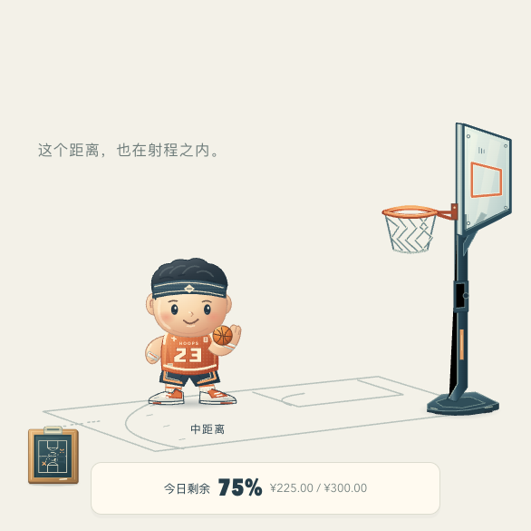
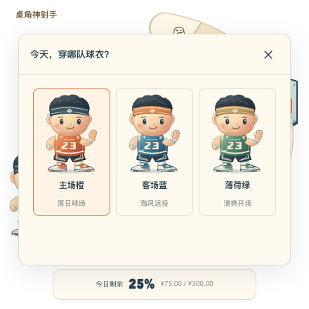
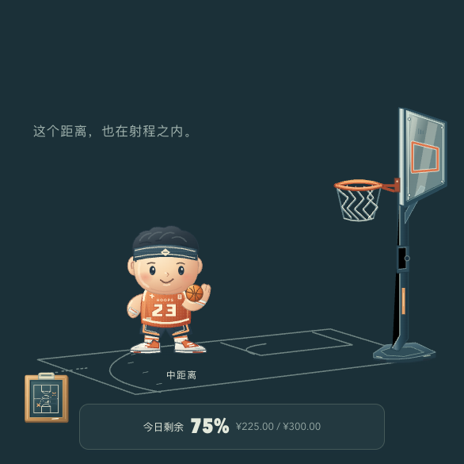
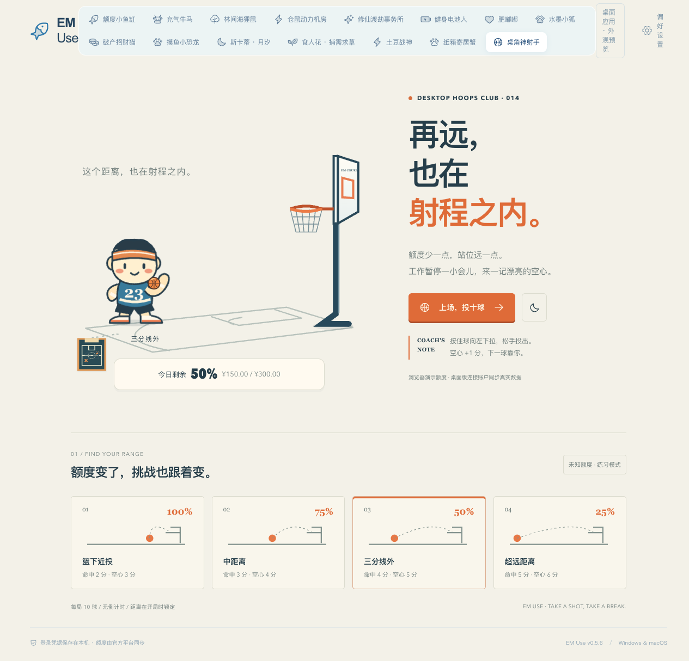
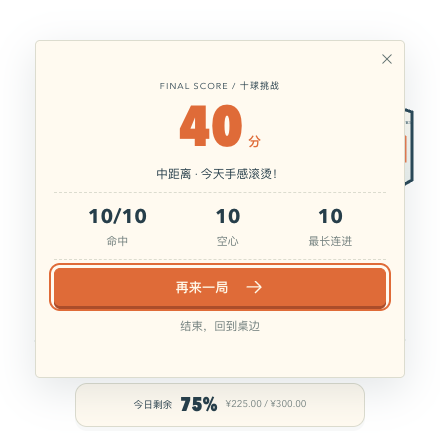
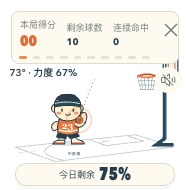
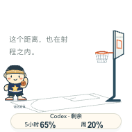

# 桌角神射手 · 投篮桌宠

2026-10-23。公共行为遵循 [桌宠基础交互规范](../../docs/desktop-pet-interaction-standard.md)。本角色接入正式 Tauri 客户端，Electron 对照基线不改动。

## 角色与场地

奶油色圆滚滚小球员、运动发带、宽大球衣和球鞋；透明场景只保留篮架、球和局部场地线。SVG 分层绘制，篮球、篮网、手臂、表情独立运动。日夜改变材质和配色，轻柔模式取消待机、庆祝及尾迹，保留投篮物理。衣橱提供主场橙、客场蓝、薄荷绿，沿用共享设置与持久化。

额度用共享 petQuotaIndex 四等分映射：>75% 篮下 2 分、>50% 中距离 3 分、>25% 三分线外 4 分、≤25% 超远距离 5 分。未知显示 —，使用明确标注的中距离练习，不视作低额；0% 仍可玩。Codex 展示实际返回的所有窗口，站位使用共享额度比例。每局锁定站位，额度数字继续同步，下一局更新距离。没有有效额度时的练习同样 10 球，不生成真实额度。

## 物料精修 · 2026-10-23

球员改为有明暗体积的运动公仔：头发分束、皮肤柔和渐变、眼睛高光、发带织纹、球衣网眼与缝线、运动号码、分层球鞋和罗纹袜。三套球衣与三套 Codex 星章款各自保留完整的亮部 / 主色 / 暗部配色。衣橱修正了通用 SVG 图标高度造成的缩略图过小问题，迷你窗口可滚动选衣。

篮架补充金属倒角、调节套筒、螺栓、配重底座、半透明篮板反光、双层篮圈和编织网；篮球补充皮革颗粒、凹缝及球面光照。日程战术板、消息储物柜和更新鞋盒同步精修。新增 `BasketballCourt`、`BasketballBall`、`BasketballProps` 分离物料层；所有内联渐变 / 纹理使用 Vue 实例 ID，避免衣橱同时出现多个角色时串色。不使用位图、滤镜或外部字体，透明场景仍只绘制人物、器材及场地线。

投篮物理、篮圈 / 篮板碰撞位置、分数、额度映射及共享桥接逻辑未改动。球员手臂与篮圈前后景继续独立运动。

本轮验证：正式 `rust-desktop` 构建通过（契约、类型检查、Vite）；原有投篮 7 项测试通过；浏览器 10 项检查通过，包含 180 / 300 / 440 / 800px 的四档实际鼠标命中、日夜、六套配色、衣橱并排渐变隔离、迷你衣橱滚动换装、通知道具、击掌与键盘出手。尺寸检查通过浏览器原生桥接桩执行。未进行原生 macOS / Windows 或真实账户验证，未打包发布。详细结果见 [本轮验证记录](design/basketball-v2/verification.json)。

## 独立玩法

| 动作 | 入口、手势与区域 | 反馈与完成 | 取消与重入 |
| --- | --- | --- | --- |
| 十球挑战 | 点击篮球、弧带或玩法面板；按住篮球往左下拉，松手出手 | 角度/力度决定初速，固定步长重力与篮板/篮圈碰撞，向下穿过篮圈计一次；每球自动回手，10 球结算 | Esc 或结束退出；再来一局清空本局并重新取站位 |
| 键盘投篮 | 聚焦篮球，Enter 开局；左右调角度、上下调力度、Space/Enter 出手 | 与鼠标使用同一物理，不提供自动命中；显示角度与力度 | Esc 退出；失焦取消拉球，不消耗球数 |
| 击掌 | 轻点球员身体或弧带击掌 | 短暂挥手、台词，约一秒回待机 | 开局/面板/换宠结束；拖窗不触发击掌 |
| 球衣 | 弧带衣橱、设置 | 切换完整球衣配色，保存本角色选项 | 关闭/Esc；与其他面板互斥 |

空心加 1 分；篮圈触碰排除空心，擦板也排除空心。连进三球提供短暂尾迹，计分不倍增。出手后的反馈来自实际碰撞。首版音效为会话内可选项，默认静音。10 球无倒计时，结束后展示命中、空心、最长连进与总分。

## 操作与生命周期

篮球命中按钮使用 data-pet-gesture 排除公共拖窗，球员身体使用 scene-hit 保留 5px 拖窗规则。捕获只属于当前拉球指针；pointercancel、失焦、隐藏、退出、换场景和卸载清除捕获。隐藏暂停物理，恢复后从原处继续，不追赶后台时长。缩放途中取消拉球。游戏期间弧带和缩放柄让位，始终保留结束入口。面板独立滚动，180px 下仍可关闭。

设置、托盘、场景选择、额度、账户、消息、日程和更新复用现有服务。投篮从不调用额度写入。未知、过期、重置均由共享状态解释；回升后闲置站位恢复，本局不移动篮筐。

## 首版功能验收记录

- 源码 / 自动测试：`npm run build`（包括共享契约生成、类型检查、Vite 构建）通过；`npm test` 的 229 项 TypeScript 测试及 12 项脚本测试通过。投篮新增 7 项测试，覆盖额度边界 / 未知 / 回升、各档可重复命中、向下穿圈计分、碰撞、十球结算、输入限制与共享设置校验。
- 浏览器真实鼠标 / 键盘操作：四档逐一拖球空心命中；完整 10 球与 60 分结算、再来一局、空心与连中统计；刷新额度只更新读数；未知练习；三款普通 / Codex 球衣、面板保持、日夜；球衣通过新标签页及刷新确认保存在浏览器共享设置中；失焦、Esc、pointercancel、隐藏与恢复、飞行中换宠清理均已验证。浏览器演示使用模拟额度。
- 浏览器原生界面模拟：180 / 190 / 300 / 440px 的方形布局、悬停工具栏、关闭 / 退出、按比例拖球命中通过；篮球操作未调用共享拖窗，角色身体拖动调用共享服务且没有附带击掌。该项使用桥接桩，不能证明实际 OS 拖窗、穿透或托盘。
- Codex 浏览器快照：真实组件展示双窗口百分比，较低比例决定距离；周窗口单独返回不补造五小时额度；过期保留并标注、退出显示 —；四种尺寸可读。账户查询本身未实际验证。
- macOS 原生：未运行实际桌面窗口验收；Windows 原生：未验证；真实账户：未连接验证；未生成或发布安装包。
- `cargo fmt --check` 检出了 `windows.rs` 既有消息窗口 `set_focus()` 语句的换行差异（非投篮修改区域），未为此改动其他逻辑；未进行 Rust 编译或原生自动测试。

详细结果见 [机器可读验证记录](design/basketball-v1/verification.json)。

可复跑脚本：`tests/basketball.test.ts`、`tests/fixtures/basketball-browser-qa.js`、`tests/fixtures/basketball-native-browser-qa.js`、`tests/fixtures/basketball-final-browser-qa.js`。后二者明确使用浏览器原生桥接桩。独立验收入口为 `/tests/fixtures/basketball-preview.html`；正式预览入口为 `/?scene=basketball`。

当前试玩的皮肤、额度和玩法全部由实际 Vue / SVG / 物理代码呈现。Codex 球衣使用独立 SVG 配色与星形徽章，并接入公共觉醒状态机；不使用旧桌宠位图图集，所以图集测试只校验使用图集的角色。完整形象与转换以浏览器效果为证，未宣称原生验证。

以下图片为首版功能验收归档，当前素材见上方精修版。

 
