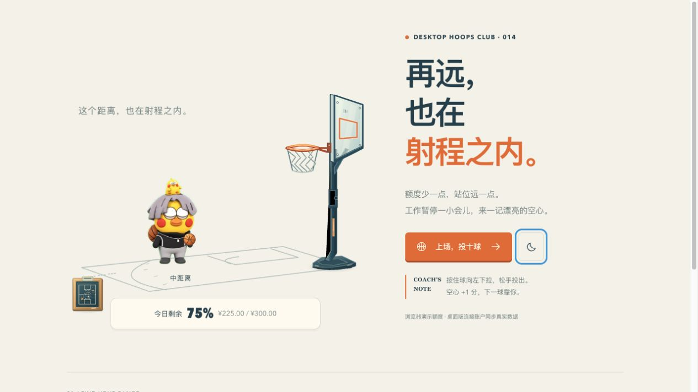
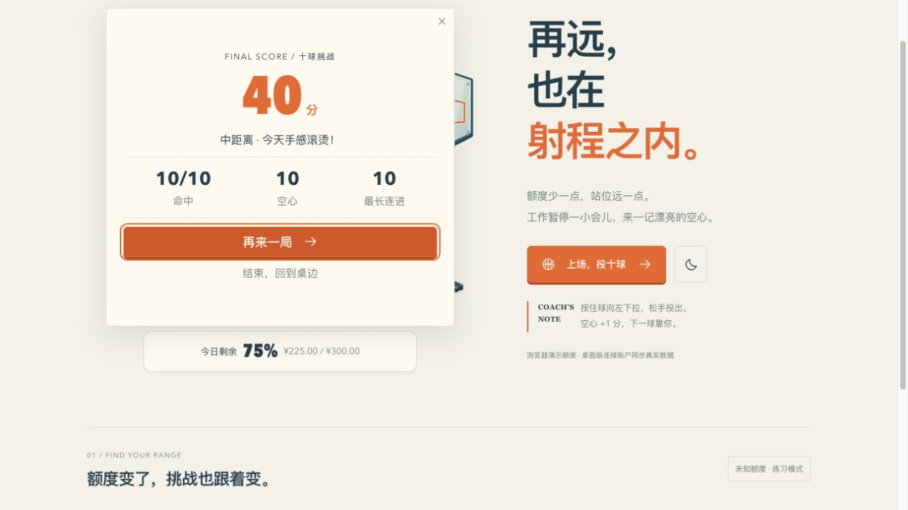
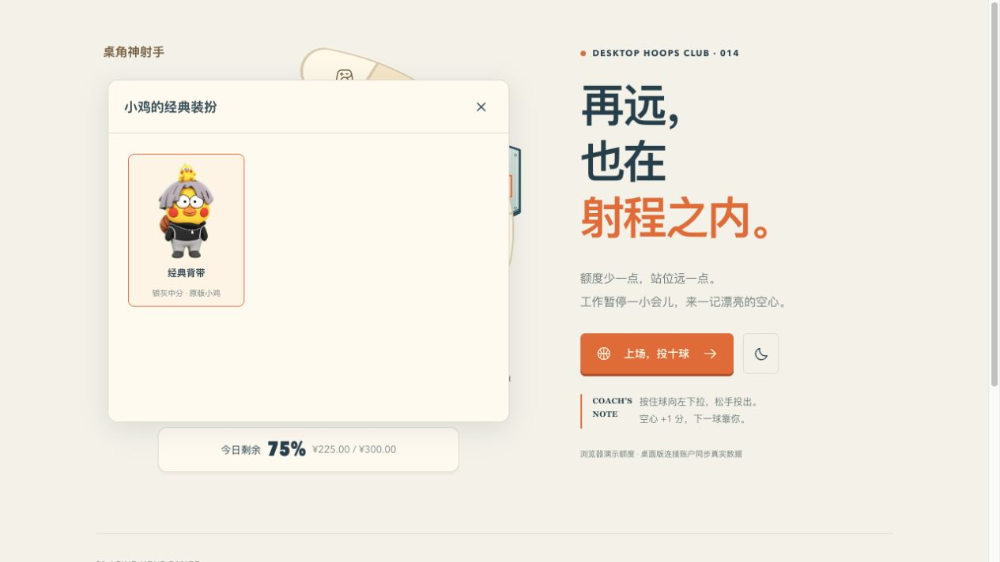
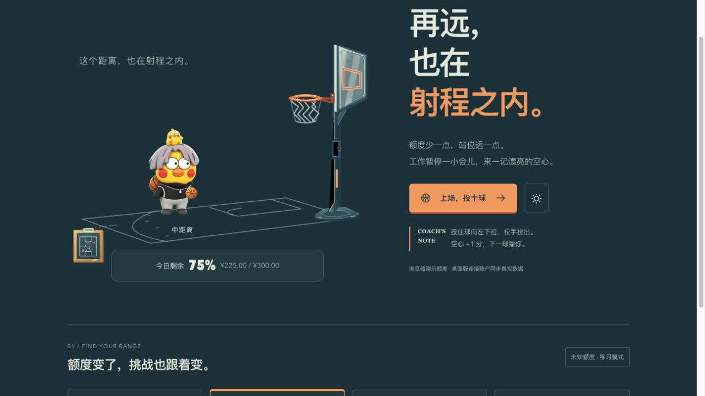

# 投篮小鸡替换

2026-10-26。遵循 [桌宠基础交互规范](../../../../docs/desktop-pet-interaction-standard.md)。

## 素材来源

- 页面：[jige / jige-cxk](https://codex-pets.net/#/pets/jige-cxk)，作者 ikun。
- 原包：https://codex-pets.net/api/pets/jige-cxk/download?v=1784105593414
- 原始清单：[source-pet.json](source-pet.json)。WebP 原样保存于 `public/assets/basketball/jige/spritesheet.webp`，1536 × 1872，8 列 × 9 行，每格 192 × 208，1,517,942 字节。
- SHA-256、尺寸和来源登记在 `docs/native-assets.json`。仅下载数据素材，没有执行网页提供的安装指令。网站标注为社区分享素材；包中没有附带独立授权文件，本记录不增加授权声明。
- 原图自带背后的装饰篮球；游戏球仍由独立物理对象和 BasketballBall 绘制。

## 当前行为

`BasketballPlayer` 使用原图集；设置缩略图和衣橱共用同一组件。动作映射与帧边界由 `basketball/chicken.ts` 管理，单次出手 / 失落停在最后有效帧，避免进入图集空格。轻柔模式保留动作对应的静态姿态。页面隐藏、面板打开、拖动及卸载时停止动画计时。

出手点下移 24 个场景单位至翅膀旁，球和点击热区、轨迹、物理起点共用 `origin()`。球场、额度映射、十球规则、分数、碰撞、取消路径与共享服务保留。原图没有独立投篮动作，本轮用跳跃动作回应出手，没有生成新动画。

衣橱只呈现原版「经典背带」，旧装扮值仍可读取。Codex 额度仍共用桥接；本轮不提供额外觉醒服装。

## 验证范围

- 源码 / 自动测试：以远端 v0.5.8 为基线隔离整理 v0.5.9；正式 Tauri 前端 `npm run build`（契约、类型检查、Vite）、231 项前端测试、12 项发布脚本测试、`verify:parity` 均通过，其中包含投篮 7 项及图集帧边界 / 轻柔模式 2 项。生成契约没有额外差异。
- 浏览器：真实组件加载本地图集；待机、击掌（第 3 行）、键盘出手、中距离十球挑战 10/10 命中和 40 分结算；退出回待机、单套衣橱、Esc 关闭、白天 / 夜晚已检查。账户与额度使用浏览器模拟数据。
- 素材：隔离发布基线保留已发布素材登记，`verify:assets` 全量通过（107 个 Tauri 素材及 56 个旧版无损素材）；原开发目录中其他未提交修改未带入。
- 原生 macOS / Windows：未验证 OS 拖窗、透明窗口或托盘。真实账户：未连接验证。安装包由 GitHub Actions 标签工作流构建，结果以对应 v0.5.9 工作流为准；本记录不代表原生安装或真实账户验收。

