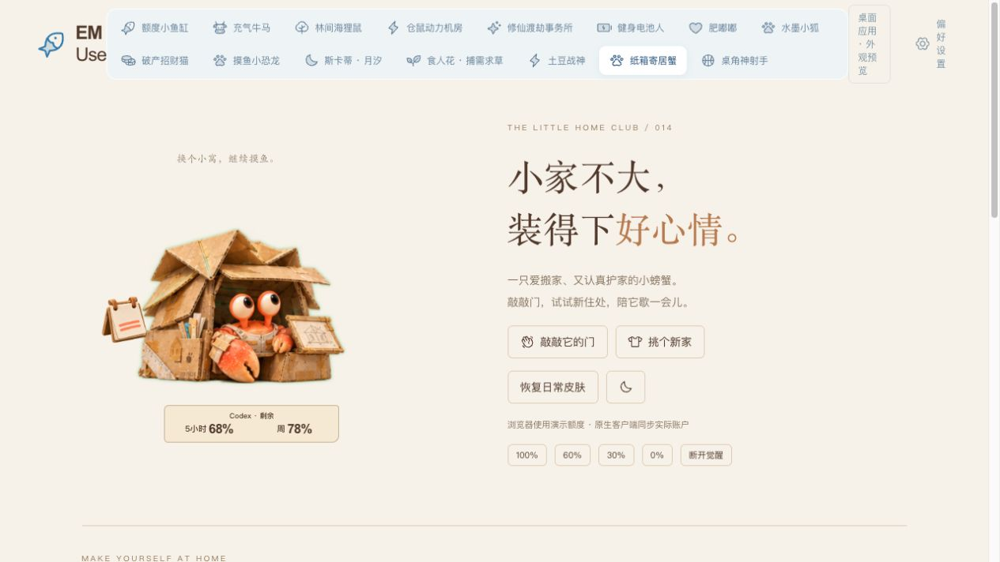

# 纸箱寄居蟹：第一版接入与验证

日期：2026-10-23。目标客户端：`rust-desktop`（Vue + Tauri）。此处记录首版功能验收；v0.5.8 发布准备与后续构建状态见 [发布记录](../../release-0.5.8.md)。

## 已接入

- 场景选择、设置缩略图、衣橱、原生托盘场景和日程场景白名单。
- 纸箱小窝、汽水公寓、城堡豪宅；对应折纸工程师、汽泡航行员、星堡守护者。每套普通与觉醒图集均包含四档额度姿态、挥钳和伸钳动作，共六帧。
- 三套六关键帧变身素材，接入共享 1.6 秒觉醒调度、来源恢复、动作阻塞排队和素材准备机制；轻柔与关闭动效遵循共享设置。
- 叶片帽、歪工牌、邮差包；瓶盖凳、贝壳门牌、迷你盆栽。两个槽位独立保存，换来源不清空；休息时随身配件移到门边。
- 敲敲门、看新房、逗钳子、宅家休息。候选住处只预览，“住这里”才保存；羽毛支持指针拖动、方向键与空格，以及等价的单次递送按钮，三次有效抓取完成。
- 自动探头、整理、伸懒腰与打盹，25–45 秒间隔；低额度降低频次，零额/未知不随机播放。隐藏、失焦、切换皮肤会清理临时状态。
- 共用窗口手势、弧形操作栏、设置校验、账户与额度桥接、消息通知、更新提示和日程服务。角色自己的图片分别用于信封、补给包与日历。
- 未知、零额、待更新、仅周窗口等额度语义；夜间、小尺寸与减少动态效果。互动不修改真实额度。

## 实现表现的边界

这版使用透明角色关键帧、配件定位和轻量位移/旋转完成动作，没有独立骨骼绑定。设计稿中的逐关节细节（眼柄连续追踪、真实钻入新壳、坐上瓶盖凳、逐片扶旗/拉环、配件觉醒材质替换）尚未逐一实现。目前门前摆件触发短暂整理反馈；衣橱显示候选角色与卷尺。静态概念分镜不是运行截图。

运行素材来自新生成的透明 PNG，保留原始图集像素，通过元数据裁切；不是把概念板背景带入窗口。图集及生成提示见 `runtime-prompts.json`。

## 验证记录

| 层面 | 结果与范围 |
| --- | --- |
| 源码 / 自动测试 | `npm test` 通过：229 项前端测试、12 项脚本测试。新增寄居蟹测试覆盖有效抓取/去抖/退出、额度姿态、设置校验、觉醒阻塞与图集边界。 |
| 生产前端构建 | `npm run build` 通过（共享设置契约、Vue 类型检查、Vite 构建）。保留既有主包大于 500 kB 的体积提示。 |
| 原生编译 | macOS 本机 `cargo check --locked --manifest-path rust-desktop/src-tauri/Cargo.toml` 通过，临时目标目录 `/private/tmp/em-use-hermit-check`。这不等于桌面运行验收。 |
| 浏览器预览 | 实际操作验证 440/300/190 布局、190 玩法可达、换装取消与确认保存、配件保留、三次递送完成、实际指针拖羽毛计数、休息/唤醒、GPT 外观、零额/未知/仅周窗口、夜间及动效切换。使用模拟桥接与演示额度。 |
| 原生桌面 | 未启动新原生二进制；真实拖窗、跨屏、缩放、托盘、通知焦点和透明窗口待验收。 |
| 真实账户 / 外部消息 | 未连接真实账户或发送消息；真实额度读取、日历、消息、更新通知与来源切换待验收。 |
| Windows | 未编译或运行验证。 |

浏览器入口：`http://127.0.0.1:5187/?scene=hermit`。独立模拟窗口：`http://127.0.0.1:5187/tests/fixtures/hermit-preview.html`。服务停止后在 `rust-desktop` 运行 `npm run dev -- --port 5187 --strictPort`。

工作区存在另一项“桌角神射手”改动，本次保留其代码；以上只描述寄居蟹接入。测试总数包含工作区其他角色的测试。
